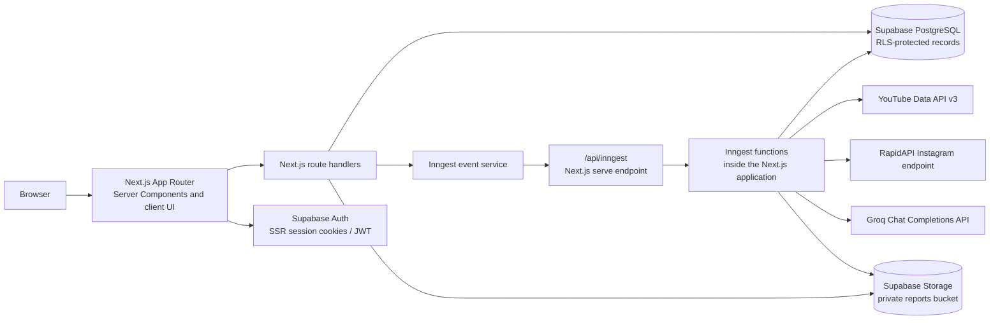
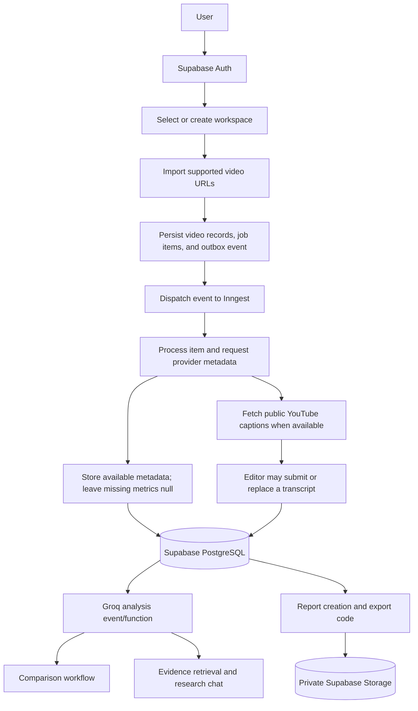
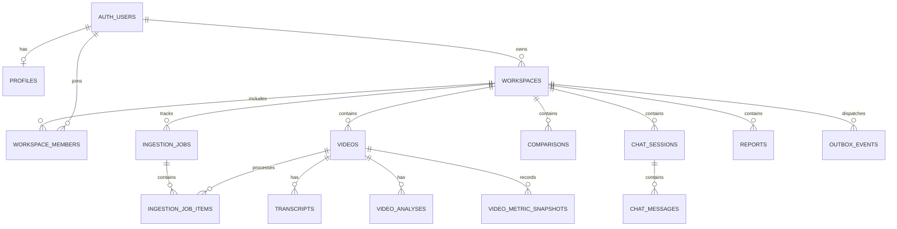

# ClipScope AI

**Short-form intelligence. Smarter content decisions.**

ClipScope AI is a Next.js application for organizing, analyzing, and comparing short-form videos from **YouTube Shorts** and **Instagram Reels**. It combines provider metadata and manually supplied or otherwise available transcript evidence with structured observations generated through Groq's free API tier. It is designed to help creators, researchers, and content teams inspect what is present in their videos—not to predict virality or prove that a particular content choice caused an outcome.


**Jump to:** [Overview](#overview) · [Features](#key-features-and-status) · [Architecture](#system-architecture) · [Setup](#installation-and-local-setup) · [Database](#database-schema) · [API](#api-and-provider-integrations) · [Testing](#testing-and-code-quality) · [Deployment](#production-deployment) · [Contributing](#contributing)

## Table of contents

- [Overview](#overview)
- [Key features and status](#key-features-and-status)
- [Screenshots and demo](#screenshots-and-demo)
- [Technology stack](#technology-stack)
- [System architecture](#system-architecture)
- [Main user workflow](#main-user-workflow)
- [Project structure](#project-structure)
- [Prerequisites](#prerequisites)
- [Installation and local setup](#installation-and-local-setup)
- [Environment variables](#environment-variables)
- [Database schema](#database-schema)
- [Authentication and security](#authentication-and-security)
- [Video ingestion and background jobs](#video-ingestion-and-background-jobs)
- [AI analysis and research chat](#ai-analysis-and-research-chat)
- [API and provider integrations](#api-and-provider-integrations)
- [Testing and code quality](#testing-and-code-quality)
- [GitHub Actions and CI](#github-actions-and-ci)
- [Production deployment](#production-deployment)
- [Troubleshooting](#troubleshooting)
- [Security best practices](#security-best-practices)
- [Limitations and implementation notes](#limitations-and-implementation-notes)
- [Roadmap](#roadmap)
- [Contributing](#contributing)
- [License and acknowledgements](#license-and-acknowledgements)

## Overview

### What it does

ClipScope AI provides a workspace-based research interface for importing supported short-form video URLs, keeping provider metadata and transcript status together, reviewing available metrics, comparing selected videos, asking evidence-oriented questions, and preparing exports.

The problem it aims to address is fragmented short-form research: information about a video, its transcript, its engagement data, and observations about its structure can otherwise be spread across platform pages and notes. ClipScope groups those records and makes the available evidence easier to inspect.

The current application is intended for individual creators, content strategists, and research teams who want to review their own collections of public YouTube Shorts and Instagram Reels. Workspaces and role-aware membership are represented in the application and database; email invitations are not implemented.

### Data and AI observations

- **Retrieved data** is metadata returned by the configured YouTube Data API or the configured RapidAPI Instagram provider. Missing values are stored as `null` and should be treated as unavailable, not as zero.
- **Transcripts** are fetched from public YouTube caption tracks when available; Instagram Reels still require a manually supplied transcript. Missing captions remain unavailable rather than being guessed.
- **AI observations** are generated by Groq from the title, description, platform, duration, available transcript text, and/or previously stored analysis, depending on the task. They are generated interpretations, not source-platform facts.
- The prompts ask the model to stay within supplied evidence, and the chat route filters citations to retrieved video IDs. The implementation does not independently verify that every AI-written excerpt is an exact verbatim quote, so citations should be reviewed as references rather than treated as proof.

The platform does not implement virality prediction, causal inference, or guarantees about content performance.

## Key features and status

The table describes what is present in the repository, not what has been verified against live external services.

| Capability | Implementation status |
|---|---|
| Registration, sign-in, password recovery, and sign-out | Implemented through Supabase Auth forms, SSR session cookies, and an auth callback. Requires a configured Supabase project. |
| JWT sessions and protected application routes | Implemented through Supabase SSR clients, `proxy.ts`, protected layouts, and server-side `requireUser` checks. |
| Workspaces | Workspace creation, selection, update, deletion, and role checks are implemented. New signups receive a profile and default workspace via a database trigger. |
| Workspace members | Member listing and role changes by Supabase user ID are represented in API/database code. There is no invitation email flow. |
| YouTube Shorts and Instagram Reels URL import | UI and API accept supported URLs, normalize them, skip duplicates in a workspace, and create job records. The batch UI allows up to 10 URLs. |
| Video metadata | YouTube Data API v3 and a RapidAPI Instagram adapter are implemented. Provider keys and live provider access are required; live behavior has not been verified here. |
| Transcript retrieval | YouTube public captions are fetched when the player exposes a caption track. Instagram speech transcripts are not provided by the configured metadata API. |
| Manual transcript entry | Implemented through `POST /api/videos/[id]/transcript`; the route upserts the transcript and schedules fresh analysis. |
| Video library and details | Implemented with filtering, sorting, pagination, status indicators, and video detail routes. |
| Side-by-side comparisons | UI, persistence, API routes, and an Inngest comparison function are present. Background execution uses the server-only Supabase worker client; live Inngest/Supabase behavior still requires a configured smoke test. |
| Groq video analysis | Analysis runs from a transcript when available, or from title/description with explicit limits when captions are missing. |
| Research chat | Sessions, messages, a retrieval function, Groq answer generation, and citation display are implemented. Retrieval currently uses `ILIKE` plus application-side term-frequency scoring—not the database `tsvector` indexes. |
| Analytics dashboard | Current workspace totals, platform distribution, job outcomes, transcript/analysis coverage, current metric averages, and a derived likes/views ratio are displayed. It is not a historical time-series dashboard. |
| Historical metric snapshots | A `video_metric_snapshots` table and policies exist, but no snapshot scheduler/writer or historical analytics view was found. |
| PDF, CSV, and Markdown report generation | Generator code and private Storage upload/download code exist. The report-create path now inserts the required `created_by` field and accepts `report_type: "summary"` (added to the SQL check constraint by the worker/storage security migration), so report records can be created and dispatched to the generation workflow. Report downloads are authorized through an authenticated route that checks workspace membership. |
| Background ingestion, progress, retry, and recovery | Job/outbox records, Inngest functions, status APIs, retry handlers, and a five-minute reconciliation function are implemented. Background functions now use a server-only service-role Supabase client (`createAdminClient`, `SUPABASE_SERVICE_ROLE_KEY`) so RLS-protected worker writes succeed without an end-user session. Idempotency keys, bounded retries, terminal states, and stale-job reconciliation are all in place. |
| Private report storage | The code targets a private Supabase Storage bucket named `reports`; create the bucket and apply the workspace-scoped policies in `supabase/storage-setup.sql` or the versioned migrations. |

## Screenshots and demo

No application screenshots or product demo media are included in the repository. The files under `public/` are generic framework SVG assets, not ClipScope product screenshots.

When real screenshots are available, add them under a tracked path such as `docs/screenshots/` and update this section. Useful captures would include:

- Landing page
- Dashboard
- Video library and video detail
- Comparison list and comparison detail
- AI insights
- Research chat
- Analytics
- Reports

Do not treat mockups or sample data as live product evidence.

## Technology stack

Versions below follow the checked-in package manifest and lockfile ranges, not the older stack descriptions in some project notes.

| Technology | Purpose | Where it is used |
|---|---|---|
| Next.js `^14.2.15` App Router | Web application, server-rendered pages, and route handlers | `app/`, `proxy.ts`, `next.config.js` |
| React and React DOM `^18.3.1` | UI rendering | `app/`, `components/` |
| TypeScript `^5` | Application and domain types | `app/`, `components/`, `lib/`, `tests/` |
| Tailwind CSS `^3.4.19` | Utility styling and theme | `app/globals.css`, `tailwind.config.js`, `postcss.config.js` |
| Radix UI packages and local primitives | Accessible dialogs, menus, tabs, selects, and related controls | `components/ui/`; these are locally composed, shadcn-inspired components, not a generated shadcn/ui installation |
| Supabase Auth, PostgreSQL, and Storage | Authentication, relational persistence, RLS, and report files | `@supabase/ssr`, `@supabase/supabase-js`, `lib/supabase/`, `supabase/` |
| Inngest `^4.23.0` | Event endpoint and durable workflow definitions | `lib/inngest/`, `app/api/inngest/` |
| Groq Chat Completions API | Server-only structured AI analysis and answers using strict JSON Schema | `lib/ai/groq.ts` |
| YouTube Data API v3 | YouTube Shorts metadata | `lib/adapters/youtube.ts` |
| RapidAPI Instagram data endpoint | Instagram Reel metadata | `lib/adapters/instagram.ts` |
| TanStack Query `^5.104.2` | Client query provider/state utilities | `components/providers/` |
| Recharts `^3.10.1` | Analytics charts | `components/analytics/` |
| React Hook Form and Zod | Form handling and validation schemas | `lib/schemas/`, auth and form components |
| PDFKit `^0.20.2` | PDF report bytes | `lib/reports/generator.ts` |
| Node.js native test runner | Unit tests | `tests/`, `npm test` |
| ESLint 9 and TypeScript compiler | Lint and type-check scripts | `eslint.config.mjs`, `npm run lint`, `npm run type-check` |
| GitHub Actions | Repository CI checks | `.github/workflows/ci.yml` |

The dependency manifest declares Next.js 14 and React 18. Older architecture notes describe Next.js 16, React 19, and Tailwind CSS 4; those claims do not match `package.json` and should not be used for setup decisions.

## System architecture

The repository uses the Next.js application as both the browser-facing application and the HTTP host for server routes and the Inngest webhook. Supabase Auth provides the session; PostgreSQL enforces access through RLS. Provider and Groq API calls are server-only.



Inngest functions and outbox operations use a server-only Supabase admin client because webhook requests do not carry a user's session cookie. Configure `SUPABASE_SERVICE_ROLE_KEY` only as a server-side deployment secret. The service role bypasses RLS, so user-facing routes must complete their workspace and role checks before invoking privileged helpers. Live workflow behavior still needs verification against configured Supabase and Inngest projects.

Primary data flow represented by the current code:



The diagram reflects implemented code paths, not a claim that all external/background flows have passed live verification. In particular, the report create contract and background worker authorization need fixes before the last steps can be relied on.

## Main user workflow

1. **Register or sign in.** Supabase Auth handles credentials and session cookies. Configure the callback URL in Supabase before testing email flows.
2. **Create or choose a workspace.** The signup trigger creates a default workspace. Users can make more workspaces and switch the active workspace.
3. **Import videos.** Paste supported YouTube Shorts or Instagram Reels URLs into the library. The API validates the request, checks editor access, normalizes URLs, skips duplicate videos already in that workspace, and persists job records.
4. **Process an ingestion job.** The route writes an outbox event and attempts an immediate Inngest dispatch. A reconciliation workflow is defined to redispatch pending events and handle stale queued jobs. This step requires the Next.js Inngest endpoint and Inngest dev/cloud service; successful worker database writes are not currently verified because of the RLS/session issue above.
5. **Retrieve metadata and transcripts.** YouTube metadata requires `YOUTUBE_API_KEY`; Instagram metadata requires `RAPIDAPI_KEY`. Public YouTube captions are fetched when available. Instagram speech transcripts can be added manually.
6. **Analyze and compare.** AI analysis requires `GROQ_API_KEY`; the default `openai/gpt-oss-20b` model is on Groq's free plan and supports strict JSON Schema responses. Video/comparison generation code runs via Inngest. AI results are observations from supplied text and metadata, not performance guarantees.
7. **Ask a research question.** The chat code retrieves workspace evidence, submits the question and selected excerpts to Groq, and saves the answer/citations. It requires a Groq API key and actual workspace evidence.
8. **Export a report.** The generator creates PDF, CSV, and Markdown files and Storage code uploads them privately. The flow requires the `reports` bucket, configured worker credentials, and a staging smoke test.

## Project structure

```text
.
├── app/
│   ├── (app)/                 # Authenticated dashboard and product routes
│   │   ├── analytics/
│   │   ├── chat/
│   │   ├── compare/           # Comparison list and [id] detail
│   │   ├── dashboard/
│   │   ├── insights/
│   │   ├── integrations/
│   │   ├── jobs/[id]/
│   │   ├── library/            # Library and [id] detail
│   │   ├── reports/
│   │   ├── settings/
│   │   ├── workspaces/
│   │   └── layout.tsx          # Protected app shell
│   ├── api/
│   │   ├── chat/
│   │   ├── comparisons/
│   │   ├── inngest/
│   │   ├── jobs/
│   │   ├── profile/
│   │   ├── reports/
│   │   ├── videos/
│   │   └── workspaces/
│   ├── auth/                   # Login, register, recovery, callback, reset, signout
│   ├── globals.css
│   ├── layout.tsx
│   └── page.tsx                # Public landing page
├── components/
│   ├── analytics/
│   ├── chat/
│   ├── compare/
│   ├── jobs/
│   ├── layout/
│   ├── library/
│   ├── providers/
│   ├── reports/
│   ├── settings/
│   ├── ui/
│   └── workspaces/
├── docs/
│   ├── ARCHITECTURE.md
│   └── E2E_SMOKE_TEST.md       # Manual procedure; not automated integration proof
├── hooks/                      # Shared React hooks
├── lib/
│   ├── adapters/               # YouTube and Instagram provider adapters
│   ├── ai/                     # Groq prompts, schemas, retry/error handling
│   ├── api/                    # API errors, validation helpers, rate limit, SSRF checks
│   ├── auth/                   # Server auth and redirect helpers
│   ├── chat/                   # Evidence retrieval and grounded answer orchestration
│   ├── ingestion/              # Job creation, outbox, processing and reconciliation
│   ├── inngest/                # Inngest client and workflow functions
│   ├── profile/
│   ├── reports/                # PDF, CSV, and Markdown generation
│   ├── schemas/                # Zod request schemas
│   ├── supabase/               # Browser, server, and proxy clients/configuration
│   ├── types/                  # Domain and database types
│   ├── workspace/              # Workspace and workspace-scoped data access
│   └── utils.ts
├── public/                     # Generic framework SVG assets; no product screenshots
├── supabase/
│   ├── migrations/             # Versioned SQL migrations
│   ├── schema.sql              # Consolidated SQL schema snapshot
│   └── storage-setup.sql       # Reports bucket policies; review caveat below
├── tests/                      # Node test runner tests and loader/mocks
├── .github/workflows/ci.yml
├── .gitignore
├── ARCHITECTURE.md             # Architectural notes (some stack claims are stale)
├── HANDOVER.md                 # Handover notes; verify claims against source
├── package.json
├── package-lock.json
├── proxy.ts                     # Supabase session refresh and route gate
└── next.config.js
```

## Prerequisites

### Required for local application development

- **Node.js:** `package.json` requires Node.js 22.6 or later, matching the Node 22 version used by GitHub Actions. The test command uses Node's `--experimental-strip-types` option.
- **npm:** The repository includes `package-lock.json`; use the npm workflow (`npm ci`).
- **Supabase project:** Required for authentication and protected application data. A local Supabase CLI project/config is not included.

### Required for specific integrations

- **Inngest:** Needed to run the defined background functions locally or in a hosted environment. The `inngest` package is present; the local CLI is fetched by the `npm run inngest` script via `npx` and therefore needs network access.
- **Groq API key:** Needed for AI analysis, comparison generation, and research answers. Create a free key at [console.groq.com/keys](https://console.groq.com/keys).
- **YouTube Data API key:** Optional to the application shell, required for YouTube metadata retrieval.
- **RapidAPI key:** Optional to the application shell, required for Instagram metadata retrieval.

Without credentials, public routes and some UI can render, but authenticated data and provider-backed features are unavailable. Public YouTube captions are fetched when exposed by the player; Instagram speech transcripts still need manual entry.

## Installation and local setup

### 1. Clone and install

```bash
git clone https://github.com/YashPanwar1408/ClipScope-AI.git
cd ClipScope-AI
npm ci
```

### 2. Create `.env.local`

Copy `.env.example` to `.env.local` and add the values needed for your setup. See [Environment variables](#environment-variables). Do not use real secrets in tracked files.

### 3. Configure the Supabase database

Create a Supabase project and open its SQL Editor. For a **new, empty project**, `supabase/schema.sql` is the consolidated schema snapshot, including workspace security and server-only outbox grants. Apply it once, then verify that the expected tables and policies exist. Do not apply the snapshot and all migrations on top of each other.

If you choose to use the versioned migrations instead, apply all files in timestamp order:

1. `supabase/migrations/20241014000000_core_schema.sql`
2. `supabase/migrations/20261014000000_auth_workspace_security.sql`
3. `supabase/migrations/20261014000001_ingestion_engine.sql`
4. `supabase/migrations/20261015000000_worker_and_storage_security.sql`
5. `supabase/migrations/20261016000000_ingestion_stall_recovery.sql`
6. `supabase/migrations/20261016010000_fix_compute_job_progress_ambiguous_job_id.sql`

The ingestion migration uses the timestamp function defined by the core schema. The worker/storage migration enables RLS and restricts outbox table access to `service_role`; the application writes and dispatches outbox events through server-only helpers. Use either the complete migration sequence or the consolidated schema snapshot, not both. Review the resulting policies in a non-production Supabase project before rollout.

### 4. Configure Supabase Auth

In the Supabase dashboard, configure the local Site URL as `http://localhost:3000` and allow the callback URL `http://localhost:3000/auth/callback`. Add the equivalent URLs for your real production origin after deployment. Email/password authentication is implemented; configure confirmation and recovery behavior in the Supabase Auth settings.

### 5. Configure Storage if testing report exports

Create a **private** bucket named `reports` in Supabase Storage, then run `supabase/storage-setup.sql` if you applied the consolidated schema snapshot. The policies scope objects to the workspace ID in the first path segment and use `EXISTS` checks, so users who belong to multiple workspaces are supported. The versioned migration path already creates these policies. Verify access with separate workspace users before storing private reports.

### 6. Configure provider keys

Add the desired server-only credentials from the table below. Enable YouTube Data API v3 for the Google Cloud project that owns `YOUTUBE_API_KEY`. `RAPIDAPI_KEY` is used with the configured RapidAPI Instagram data endpoint. Provider-specific access, terms, quotas, and availability are controlled by those providers.

### 7. Start the application and Inngest locally

Start the Next.js app in one terminal:

```bash
npm run dev
```

For background workflows, start the Inngest development CLI in a second terminal:

```bash
npm run inngest
```

The CLI script runs `npx inngest-cli@latest dev`; it may download the CLI at run time. The application exposes the Inngest handler at `/api/inngest`. Run the local workflow setup only after the app is available, and remember that the worker/RLS issue described earlier still applies.

Open [http://localhost:3000](http://localhost:3000).

## Environment variables

No real credentials belong in this file. Public Supabase values are intentionally named `NEXT_PUBLIC_*` because Supabase's publishable/legacy anon key is used by browser and server clients; database security must come from RLS. Groq and provider credentials must remain server-side.

| Variable | Required? | Purpose | Where to obtain it |
|---|---|---|---|
| `NEXT_PUBLIC_SUPABASE_URL` | Yes for auth/data | Supabase project URL | Supabase project API settings |
| `NEXT_PUBLIC_SUPABASE_PUBLISHABLE_KEY` | Yes for auth/data, preferred | Public/publishable key used by Supabase SSR/browser clients | Supabase project API settings |
| `NEXT_PUBLIC_SUPABASE_ANON_KEY` | Optional fallback if publishable key is not set | Legacy public anon key; accepted by `lib/supabase/config.ts` | Supabase project API settings |
| `GROQ_API_KEY` | Optional; required for AI requests | Server-side Groq API authentication | [Create a free Groq API key](https://console.groq.com/keys) |
| `GROQ_MODEL` | Optional | Overrides the model name; default is `openai/gpt-oss-20b` | Use a Groq model that supports strict structured outputs |
| `YOUTUBE_API_KEY` | Optional; required for YouTube metadata | Server-side YouTube Data API v3 access | Google Cloud project with YouTube Data API v3 enabled |
| `RAPIDAPI_KEY` | Optional; required for Instagram metadata | Server-side key for the configured RapidAPI Instagram endpoint | RapidAPI account and subscription for the endpoint |
| `INNGEST_EVENT_KEY` | Optional for local CLI; required when sending events to hosted Inngest | Inngest event publishing credential; recognized by the Inngest SDK and integration status page | Inngest app/environment settings |
| `INNGEST_SIGNING_KEY` | Optional for local CLI; required for a hosted signed endpoint | Inngest webhook signature verification; used by the Inngest serving SDK | Inngest app/environment settings |
| `SUPABASE_SERVICE_ROLE_KEY` | Required for background workers | Server-only service-role key used by Inngest workflow functions to write to RLS-protected tables without an end-user session. Never expose in browser code. | Supabase project API settings |

Background functions use a server-only service-role Supabase client (`createAdminClient`, `SUPABASE_SERVICE_ROLE_KEY`) so RLS-protected worker writes succeed without an end-user session. Never add `SUPABASE_SERVICE_ROLE_KEY` to browser code.

## Database schema

The core PostgreSQL schema is defined in `supabase/migrations/20241014000000_core_schema.sql`. `supabase/schema.sql` is the consolidated snapshot. The ordered migration path and snapshot are alternative setup paths; keep them aligned when schema changes are made.

| Table | Purpose and relationships |
|---|---|
| `profiles` | Profile details keyed to `auth.users.id`. |
| `workspaces` | Workspace owner, name, and description. The owner references Supabase Auth. |
| `workspace_members` | Workspace/user membership and role (`owner`, `admin`, `editor`, `viewer`); composite primary key on workspace and user. |
| `videos` | Workspace-scoped YouTube Shorts/Reels records, provider IDs, current metadata/metrics, and statuses. A unique constraint prevents duplicate platform IDs in one workspace. |
| `ingestion_jobs` | Workspace-scoped batch status, progress, requester, idempotency key, and error fields. |
| `ingestion_job_items` | Per-video item status and errors for an ingestion job. |
| `transcripts` | Transcript text, language, optional segments, source, and confidence; linked to a video. |
| `video_analyses` | Structured analysis fields, evidence JSON, model name, and analysis version; linked to a video. |
| `video_metric_snapshots` | Timestamped metrics linked to a video. The schema exists, but no snapshot writer was found. |
| `comparisons` | Workspace, creator, selected video IDs, and generated comparison JSON. A trigger validates selected videos belong to the workspace. |
| `chat_sessions` | Workspace and user-owned chat sessions. |
| `chat_messages` | User/assistant messages and citation JSON, linked to a session. |
| `reports` | Workspace report metadata, state, and Storage path. SQL permits `pdf`, `markdown`, or `json`; the current report API/UI do not match these constraints. |
| `outbox_events` | Durable event-dispatch payloads and retry/error state, linked to a workspace. RLS is enabled and end-user roles have no table privileges; server-side workers use the service role. |

The schema includes foreign keys, cascade rules, uniqueness constraints, lookup indexes, generated search vectors, triggers for signup/workspace creation and timestamps, and `compute_job_progress()` for job state aggregation. It creates PostgreSQL `tsvector` columns and GIN indexes for video and transcript text, but the current chat retrieval implementation does not query those vectors.

### Entity relationships



RLS policies in the hardened schema scope data to the authenticated user through workspace ownership/membership and role checks. Workspace access and mutation checks are also performed in server helpers. The schema includes security-definer helpers for membership and role management; review changes to these policies as part of any schema modification. Applying SQL through the Supabase SQL Editor does not create CLI migration history; keep the selected setup path and applied SQL version documented for each environment.

## Authentication and security

- Supabase Auth handles email/password registration, login, recovery, and sign-out.
- `@supabase/ssr` clients read/write the session cookie in server and browser contexts. `proxy.ts` refreshes session claims and gates protected application pages; API routes perform their own checks.
- Authentication answers **who is signed in**. Authorization is separate: `requireWorkspaceAccess(workspaceId, minRole)` checks the workspace role server-side, and RLS checks the caller's JWT in PostgreSQL.
- The role hierarchy is owner, admin, editor, viewer. Typical read access is viewer; video imports and content mutations require editor or higher; workspace/member management requires admin or owner; workspace deletion requires owner.
- Do not mistake a public Supabase publishable/anon key for a privileged credential. Its exposure is expected; RLS and server authorization must be correct.
- Groq, YouTube, and RapidAPI secrets are read by server-only modules. Never prefix them with `NEXT_PUBLIC_` or include them in a client bundle.
- The `reports` bucket is intended to be private. Downloads go through an authenticated route which checks workspace membership before fetching the object.

The worker and Storage setup use server-only credentials and workspace-scoped policies. Review the applied schema and run the end-to-end checks against a staging project before production. Do not disable RLS to work around permission errors.

## Video ingestion and background jobs

The video import route validates URL input with Zod, verifies editor access, normalizes platform URLs, skips duplicates, inserts video/job/item records, and creates an outbox event. The event is dispatched immediately when possible; the reconciliation function is defined to retry pending outbox records and redispatch stale queued jobs. The Inngest endpoint is `app/api/inngest/route.ts` and registers these functions:

- `ingest-job`: processes a job's items in separate durable steps, with function-level retries and concurrency limits.
- `ai-analysis`: loads a video's metadata and transcript, asks Groq for a structured analysis, and persists the result.
- `generate-comparison`: loads selected videos and available analyses/transcripts, then stores structured comparison data.
- `generate-report`: creates Markdown, CSV, and PDF bundle files and attempts to upload them to the private `reports` bucket.
- `reconcile-jobs`: runs on the configured five-minute cron schedule and reconciles the outbox/stale jobs.

Job states include `pending`, `queued`, `running`, `retrying`, `completed`, `partial`, `failed`, and `cancelled`; item state is tracked separately. Progress is recomputed from job items. Retrying failed/partial/cancelled jobs is exposed by the API.

These workflow definitions are implemented but have not been verified against live services in this repository. Inngest webhook requests do not carry the user's auth cookie, so workflow and outbox operations use the server-only Supabase admin client. Configure `SUPABASE_SERVICE_ROLE_KEY`, `INNGEST_EVENT_KEY`, and `INNGEST_SIGNING_KEY` as deployment secrets. User-facing routes check workspace access before invoking privileged operations. Run the live smoke test against a staging Supabase/Inngest project before production rollout.

## AI analysis and research chat

### Groq analysis

`lib/ai/groq.ts` creates strict JSON Schema outputs for individual video analysis, comparisons, and research answers through Groq's OpenAI-compatible Chat Completions API. The default model is `openai/gpt-oss-20b`, overridable with `GROQ_MODEL`. Add a key as `GROQ_API_KEY` in `.env`; it is read server-side and never sent to the browser. Requests have a 30-second timeout and up to three attempts with bounded backoff for retryable errors.

For video analysis, the prompt receives available title, description (truncated), platform, duration, and transcript text. When no transcript is present the model is told that; resulting observations may be limited. Comparison prompts receive the selected videos' title/platform, existing analysis, and up to 800 characters of transcript. There is no virality model or causal claim.

### Research chat and evidence

The chat server reads transcript text and video title/description within the workspace. Current retrieval normalizes the question into terms, queries using the first term with `ILIKE`, assigns a simple term-frequency relevance score, extracts a short excerpt, and sends the selected evidence to Groq. Empty retrieval returns an explicit insufficient-evidence response. Returned citation video IDs are filtered to IDs in the retrieved evidence before saving/displaying them.

Although PostgreSQL `tsvector` columns/indexes are defined, this current retrieval code does not use `tsquery`, `websearch_to_tsquery`, or a full-text ranking function. Citation IDs are checked, but generated excerpt strings are not checked for exact transcript substring matches. Review AI responses and citations before using them as research evidence.

## API and provider integrations

These are route patterns from the App Router source. Protected endpoints require a Supabase-authenticated session and, where applicable, workspace access. The Inngest endpoint is invoked by the workflow service rather than a signed-in end user.

| Endpoint | Methods | Purpose | Authentication/authorization |
|---|---|---|---|
| `/api/videos` | `GET`, `POST` | List workspace videos; import one or a batch of supported video URLs and queue ingestion | Signed-in user; workspace viewer for listing and editor for imports |
| `/api/videos/[id]` | `GET`, `DELETE` | Read or delete a video | Signed-in user; workspace membership/role checked |
| `/api/videos/[id]/transcript` | `POST` | Add a manual transcript | Signed-in user; workspace editor |
| `/api/videos/[id]/retry-analysis` | `POST` | Request analysis again | Signed-in user; workspace role checked |
| `/api/jobs/[id]` | `GET` | Read job status/details | Signed-in user; workspace membership checked |
| `/api/jobs/[id]/retry` | `POST` | Retry failed, partial, or cancelled job items | Signed-in user; workspace editor |
| `/api/workspaces` | `GET`, `POST` | List and create workspaces | Signed-in user |
| `/api/workspaces/[id]` | `GET`, `PATCH`, `DELETE` | Read, update, or delete a workspace | Signed-in user; role-specific checks |
| `/api/workspaces/[id]/switch` | `POST` | Set the active workspace cookie | Signed-in user; workspace viewer |
| `/api/workspaces/[id]/members` | `GET`, `POST` | List members or add a member by existing user ID | Viewer for listing; admin/owner for management |
| `/api/workspaces/[id]/members/[userId]` | `PATCH`, `DELETE` | Change a member role or remove the member | Admin/owner, subject to SQL role rules |
| `/api/comparisons` | `GET`, `POST` | List/create workspace comparisons and dispatch generation | Signed-in user; viewer for listing, editor for creation |
| `/api/comparisons/[id]` | `GET`, `DELETE` | Read or delete a comparison | Signed-in user; workspace access checked |
| `/api/chat/sessions` | `GET`, `POST` | List or create research chat sessions | Signed-in user; workspace role checked |
| `/api/chat/sessions/[id]` | `PATCH`, `DELETE` | Rename or delete a session | Signed-in session owner |
| `/api/chat/sessions/[id]/messages` | `GET`, `POST` | Read messages or ask an evidence-grounded question | Signed-in user; session/workspace checks |
| `/api/reports` | `GET`, `POST` | List or create report records | Signed-in user; workspace role checked. |
| `/api/reports/[id]?format=md\|csv\|pdf` | `GET` | Download a report from private Storage | Signed-in user; workspace membership checked |
| `/api/profile` | `GET`, `PATCH` | Read/update the current profile | Signed-in user |
| `/api/inngest` | `GET`, `POST`, `PUT` | Inngest function registration and event execution | Inngest SDK endpoint/signature handling; not a user-facing endpoint |

Provider integrations are server-side adapters, not additional ClipScope public APIs:

| Integration | Purpose | Credential |
|---|---|---|
| YouTube Data API v3 `videos.list` | Fetch title, description, channel, thumbnails, duration, publication time, and available statistics | `YOUTUBE_API_KEY` |
| `instagram-looter2.p.rapidapi.com/post?url=...` | Fetch public Instagram Reel caption, owner, thumbnail, duration, and available metrics | `RAPIDAPI_KEY` |
| Groq Chat Completions | Strict structured video/comparison analysis and research answers | `GROQ_API_KEY`, optional `GROQ_MODEL` |

YouTube captions are fetched from public caption tracks exposed by the YouTube player; availability depends on the video. Instagram Looter supplies post metadata, not spoken-word transcripts. The video detail page can refresh provider data and queue analysis from available metadata; transcript-based analysis is stronger when a transcript is available.

## Testing and code quality

The scripts in `package.json` are:

| Command | Purpose |
|---|---|
| `npm run dev` | Start the Next.js development server |
| `npm run build` | Create the Next.js production build |
| `npm run start` | Serve a previously built production app |
| `npm run lint` | Run ESLint over `app`, `components`, `lib`, and `hooks` |
| `npm run type-check` | Run `tsc --noEmit` |
| `npm test` | Run the named utility, schema, adapter, URL-normalization, and report tests with Node's native test runner |
| `npm run inngest` | Run `npx inngest-cli@latest dev` |

A typical local check sequence is:

```bash
npm run lint
npm run type-check
npm test
npm run build
```

Tests cover utility/URL normalization behavior, Zod schemas, adapter behavior, and report formatting/generation. They do not establish that live Supabase, Inngest, Groq, YouTube, RapidAPI, or Storage workflows work end-to-end. The test script uses `--experimental-strip-types`; use Node.js 22.6 or later unless the test runner/script is updated. The package does not define a dedicated integration-test command.

No test, lint, type-check, or build result is claimed in this README. The commands above are present in `package.json`; they were not executed as part of this documentation change.

## GitHub Actions and CI

`.github/workflows/ci.yml` runs on pushes and pull requests targeting `main` or `develop`. It uses `ubuntu-latest`, sets up Node 22 (matching the `engines` field and the `--experimental-strip-types` test requirement), runs `npm ci`, then runs separate ESLint, TypeScript, and unit-test jobs; the build job depends on those checks and runs `npm run build`.

There are no repository-specific integration secrets configured by this workflow in the checked-in YAML. To debug a failure, open the repository's GitHub **Actions** tab, select the failed workflow run, and inspect the first failing step and its log. Configure secrets in GitHub repository/environment settings only if a future workflow explicitly needs them; do not add them to YAML or commit them.

## Production deployment

The code is a standard Next.js application and can be deployed to a compatible Next.js host such as Vercel. Vercel is described in project architecture notes, but there is no checked-in `vercel.json` or verified live deployment in this repository. Deployment should be treated as an unverified target, not an existing production URL.

1. Connect the GitHub repository to a Vercel project and select the repository root as the app root.
2. Configure the required Supabase public URL/key and any provider credentials in Vercel's environment-variable settings for the appropriate environments. Local `.env.local` values are not automatically copied to hosting.
3. Apply the database schema to the production Supabase project using the same setup path that was reviewed and tested in staging. Do not mix the consolidated snapshot with the versioned migrations.
4. Configure Supabase Auth Site URL and redirect allow-list for the real production domain, including the auth callback path.
5. If using hosted Inngest, configure its event/signing keys as server-side deployment variables and register the deployed endpoint at `https://<your-domain>/api/inngest` in Inngest. The domain is a value you supply; this README does not assume a live deployment URL.
6. Create the private `reports` bucket and review/repair its policies only if using report exports. Fix the report create contract and background worker auth path first.
7. Deploy, then verify authentication, RLS behavior with separate users/roles, provider calls, Inngest event registration, background database writes, and private report download. Review Vercel, Supabase, and Inngest logs during a staged verification.

External provider quotas, pricing, terms, and availability are controlled by Supabase, Groq, YouTube, RapidAPI, Inngest, and the chosen host. Groq currently lists `openai/gpt-oss-20b` on its Free Plan Limits page; limits and model availability can change. Check your Groq console for the limits on your account before enabling real usage.

## Troubleshooting

| Symptom | Likely cause | Diagnostic and next step |
|---|---|---|
| `npm ci` fails or dependency resolution changes | Node/npm mismatch, lockfile/environment issue, or network access | Use a supported Node release, run `npm ci` from the repository root, and preserve `package-lock.json`; do not mix npm with a different package manager. |
| `node` rejects `--experimental-strip-types` during `npm test` | The test script requires Node 22.6 or later | Use Node 22.6+ locally; GitHub Actions uses Node 22. |
| Supabase is reported unconfigured or auth redirects to an error | Missing/placeholder Supabase URL or public key, or malformed URL | Check `NEXT_PUBLIC_SUPABASE_URL` and one accepted public key variable; confirm the URL/key belong to the same project. |
| Auth callback fails or login redirects unexpectedly | Supabase Site URL/redirect allow-list does not include the local or production callback | Add the exact app origin and `/auth/callback` to Supabase Auth URL configuration; inspect the Supabase auth logs. |
| Database query returns permission/RLS errors | User lacks workspace membership/role, schema differs from the selected setup path, or a required server credential is missing | Confirm the signed-in user, workspace membership, role, applied schema, and `SUPABASE_SERVICE_ROLE_KEY` for worker operations. Do not disable RLS. |
| Outbox operations fail | The service-role key is missing, migrations are incomplete, or the selected schema is outdated | Confirm `SUPABASE_SERVICE_ROLE_KEY`, apply either the full migration sequence or current `schema.sql`, and inspect `outbox_events` grants. End-user roles should not have direct outbox access. |
| YouTube metadata is empty, returns 403, or reports quota | Missing/invalid key, API not enabled, video unavailable/private, or provider quota | Verify `YOUTUBE_API_KEY`, enable YouTube Data API v3 in its Google Cloud project, inspect the provider error and quota dashboard. Missing metrics should remain null. |
| Instagram metadata is missing or returns provider errors | RapidAPI key/subscription/endpoint availability or Instagram access restrictions | Verify `RAPIDAPI_KEY`, the endpoint subscription and provider response. Extraction is not guaranteed for every Reel. |
| No transcript is available | Automatic transcript extraction is not implemented in the current adapter | Use the manual transcript route/UI if available and authorized; do not expect an API key alone to activate transcript retrieval. |
| Groq returns 429, 502, or 503 | Rate/quota limit, transient provider failure, invalid key, or unavailable model | Check `GROQ_API_KEY`, `GROQ_MODEL`, and the limits/model availability shown in your Groq console. The service retries transient failures with bounded backoff; wait and retry after a quota limit. |
| Groq reports an unsupported model or schema | The selected model may not support strict structured outputs | Use `openai/gpt-oss-20b` or another model currently listed by Groq as supporting strict structured outputs. |
| Inngest endpoint does not register or events stay pending | App endpoint is not reachable, local CLI is not running, keys/endpoint registration are wrong, or the server-only Supabase key is missing | Run the app and `npm run inngest` in separate terminals for local development; verify Inngest's endpoint/function logs and event payloads, and confirm the server-side Inngest and Supabase keys. |
| Jobs stay queued or fail after dispatch | Event dispatch failed, no function is registered, or a required worker credential/schema is missing | Inspect job/item error fields and Inngest execution logs. Confirm the reconciliation function, `SUPABASE_SERVICE_ROLE_KEY`, and database migrations are configured. |
| Report downloads return not found/permission errors | Bucket missing, object path incorrect, bucket public/private configuration mismatch, or Storage policy issue | Confirm private `reports` bucket, object path under the workspace, and a reviewed policy supporting multiple workspaces. Check server response and Storage logs. |
| UI styles are missing or inconsistent | Tailwind build/configuration or stylesheet import issue | Confirm Tailwind 3 dependencies and `app/globals.css` imports are present, then restart the dev server and inspect build output. Do not follow stale Tailwind 4 instructions in older notes. |
| Production build fails | TypeScript, lint, framework/dependency, or environment/configuration issue | Run `npm run type-check`, `npm run lint`, and `npm run build` locally with the supported Node version; inspect the first compiler error and the corresponding host build log. |
| GitHub Actions fails on tests | A test assertion or implementation regressed | Inspect the failed step in Actions and reproduce with `npm test` under Node 22.6 or later. |

## Security best practices

- Never commit `.env`, `.env.local`, provider credentials, or deployment secrets. The current `.gitignore` excludes `.env` and `.env*.local`; verify any other environment file is ignored before adding it.
- Never expose Groq, YouTube, RapidAPI, Inngest signing, or privileged Supabase keys in browser code. The service-role client is server-only and must remain behind authorization checks.
- Keep RLS enabled and test workspace boundaries with accounts that have different roles. Authentication alone is not authorization.
- Validate all request bodies and IDs server-side; keep provider fetches behind the existing server-side adapters and URL validation.
- Keep reports in a private bucket and deliver them only through an authorization-checked endpoint. Review Storage policies and object paths.
- If a credential is committed or shared accidentally, revoke/rotate it in the provider dashboard and remove it from history through the repository's incident process.
- Use bounded retries and rate limits; the current import limiter is in-memory and does not coordinate across multiple server instances.
- Keep dependencies and provider SDKs updated, and review changes to SQL security-definer functions and RLS policies.

## Limitations and implementation notes

- **External access:** Metadata depends on provider keys, API access, quotas, public availability, and provider terms. The integrations page checks configured values; it does not prove that the provider is reachable or that calls succeed.
- **Transcripts:** YouTube transcript fetching is a stub that returns unavailable; Instagram transcript fetching is not implemented. Manual transcript entry is the implemented path.
- **Background jobs:** Workers use the server-only Supabase service role. Their behavior against live Inngest, Supabase, provider, and Storage services still needs staging smoke testing.
- **Database setup:** Choose either the complete versioned migration sequence or the consolidated schema snapshot. Apply the Storage setup script only when required by that path, and verify the resulting policies before rollout.
- **AI and evidence:** Groq outputs are model-generated observations. Chat retrieval is simple keyword filtering/scoring despite database full-text indexes, and generated quote text is not verified as verbatim. Missing or weak evidence limits answer quality.
- **Metric snapshots and analytics:** A snapshot table exists, but no capture schedule was found. Charts summarize current stored metrics and job/analysis state. Platform view counts may use different measurement conventions and are not directly comparable.
- **Rate limiting:** The in-memory limiter is not shared across serverless instances and resets on restart.
- **Documentation:** The environment template is `.env.example`; a project license is not included. Review the smoke test and setup instructions against the actual staging configuration.

## Roadmap

These are proposed follow-ups, not currently completed features:

1. Add authenticated integration/end-to-end tests for configured services.
2. Add a supported speech-to-text provider for Instagram Reels if automatic spoken-word transcripts are needed.
3. Implement metric snapshot capture and historical analytics if longitudinal comparisons are required.
4. Use the existing PostgreSQL search vectors for retrieval and verify citations against source text.
5. Add real product screenshots and a project license once those assets and licensing terms are decided.

## Contributing

Contributions are welcome. Before opening a pull request:

1. Fork the repository and create a focused branch from the current default branch.
2. Make the smallest change that addresses the issue; update tests and relevant documentation.
3. Run the available checks with the supported Node version:

   ```bash
   npm run lint
   npm run type-check
   npm test
   npm run build
   ```

4. Do not include credentials, `.env.local`, build output, or unrelated changes.
5. Open a pull request describing the behavior change, tests run, migration impact, and any required provider configuration.

For database changes, include a migration and keep it consistent with the consolidated schema and RLS model. Do not claim an integration works without testing it against its configured provider.

## License and acknowledgements

There is no `LICENSE` file in the repository, so the project's license has **not been specified**. Do not assume the code is open source or reuse it under a presumed license until the repository owner adds licensing terms.

ClipScope AI uses and integrates with Next.js, React, TypeScript, Tailwind CSS, Radix UI, Supabase, Inngest, Groq, YouTube Data API, RapidAPI, Recharts, PDFKit, and other packages listed in `package.json`. Review each provider's own terms, quotas, and attribution requirements when using the application.
