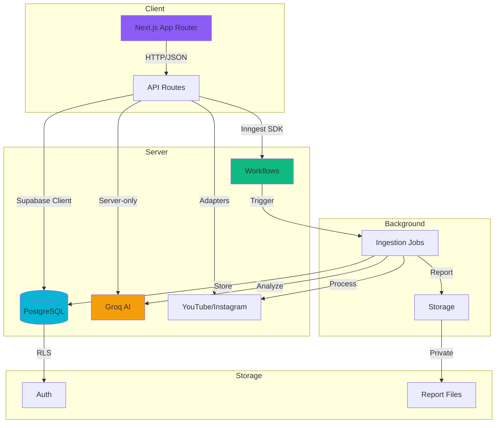

# ClipScope AI Architecture

## System Overview

ClipScope AI is a multi-tenant SaaS application for analyzing and comparing short-form video content. The architecture follows a server-first approach with Next.js App Router, Supabase for database and authentication, and Inngest for durable background workflows.

## Architecture Diagram



## Core Principles

### 1. Server-First Architecture

- All sensitive operations execute on the server
- Browser code never handles service-role keys or provider secrets
- Server Components handle initial data fetching
- API routes handle mutations and external service calls

### 2. Data Honesty

- Missing metrics remain `null` in the database
- UI displays `—` for unavailable values, never `0`
- Transcript failures are explicitly stated (`unavailable`, `error`)
- AI conclusions require transcript evidence
- No fabricated or demo data in production

### 3. Multi-Tenant Isolation

- Row Level Security (RLS) on all user-accessible tables
- Workspace-based data segregation
- Server-side authorization checks in addition to RLS
- Users cannot access other users' workspaces by modifying IDs

### 4. Durable Workflows

- Inngest handles background job processing
- Server-only outbox for reliable event dispatch
- Idempotent job creation to prevent duplicates
- Reconciliation cron for stale job recovery
- No Redis, Celery, or separate worker process required

## Technology Stack

### Frontend

- **Next.js 16.4.2**: App Router with React 19.2.0
- **TypeScript**: Strict mode with comprehensive type safety
- **Tailwind CSS v3**: Utility-first styling with custom design tokens
- **shadcn/ui**: Radix UI primitives with custom styling
- **Lucide React**: Icon library
- **TanStack Query v5**: Server state management
- **Recharts**: Data visualization

### Backend

- **Supabase PostgreSQL**: Relational database with RLS
- **Supabase Auth**: JWT-based authentication
- **Supabase Storage**: Private file storage for reports
- **Inngest**: Durable workflow orchestration
- **Groq GPT-OSS 20B**: AI analysis with strict structured output

### Infrastructure

- **Vercel**: Deployment target (serverless)
- **GitHub Actions**: CI/CD pipeline

## Database Schema

### Core Tables

1. **profiles**: User profiles with avatar URLs
2. **workspaces**: Multi-tenant workspaces
3. **workspace_members**: Workspace membership with roles
4. **videos**: Imported videos with metadata and metrics
5. **ingestion_jobs**: Background job tracking
6. **ingestion_job_items**: Per-video job status
7. **transcripts**: Video transcripts with full-text search
8. **video_analyses**: AI-generated analysis results
9. **video_metric_snapshots**: Historical metric snapshots
10. **comparisons**: Video comparison sessions
11. **chat_sessions**: Research chat sessions
12. **chat_messages**: Chat messages with citations
13. **reports**: Generated reports
14. **outbox_events**: Server-only outbox for workflow dispatch

### Key Features

- **Full-Text Search**: `tsvector` columns on videos and transcripts
- **Generated Columns**: Automatic search vector generation
- **Triggers**: Auto-populate profiles, workspaces, and timestamps
- **RLS Policies**: Workspace-based authorization
- **Foreign Keys**: Cascading deletes for data integrity
- **Unique Constraints**: Prevent duplicate video imports

## Authentication Flow

### Registration

1. User submits registration form (name, email, password)
2. Supabase Auth creates user account
3. Database trigger creates profile and default workspace
4. User redirected to dashboard or email confirmation page

### Login

1. User submits login form (email, password)
2. Supabase Auth validates credentials
3. JWT session created in HTTP-only cookie
4. User redirected to dashboard

### Session Management

- JWT tokens managed by Supabase Auth
- Session refresh handled by Supabase SSR client
- Server components verify session via `supabase.auth.getUser()`
- Protected routes use `requireUser()` helper

### Authorization

- **Workspace Access**: `requireWorkspaceAccess(workspaceId, minRole)`
- **Role Hierarchy**: owner > admin > editor > viewer
- **RLS Policies**: Enforce workspace membership at database level
- **Server Checks**: Additional verification in API routes

## Background Workflows

### Ingestion Job Flow

1. User submits video URLs
2. Server validates URLs and workspace access
3. Video records created in database
4. Ingestion job and job items created
5. Outbox event inserted after job rows by a server-only helper; reconciliation retries pending events
6. Event dispatched to Inngest (best-effort)
7. Reconciliation cron handles unsent events

### Workflow Steps

```
job/ingest.requested
  → mark-job-running
  → load-items
  → process-item (per video, parallel)
    → fetch-metadata
    → fetch-transcript
    → persist-results
  → finalize-job
    → recompute-progress
    → trigger-video/analysis.requested (for successful items)
```

### Job State Management

- **Statuses**: pending, queued, running, retrying, completed, partial, failed, cancelled
- **Progress**: Computed from job items via SQL function
- **Terminal States**: completed, partial, failed, cancelled
- **Partial Success**: Failed items don't erase successful results
- **Recovery**: Stale jobs re-queued by reconciliation cron

### Idempotency

- Client-generated `idempotency_key` prevents duplicate submissions
- Unique constraint on `(workspace_id, idempotency_key)`
- Job items check current status before processing
- Workflow steps designed for safe retries

## AI Integration

### Groq Configuration

- **Model**: `openai/gpt-oss-20b` (configurable via `GROQ_MODEL`)
- **Structured Output**: ResponseSchema for type-safe results
- **Evidence Grounding**: AI requires transcript evidence
- **Timeout**: 30-second request timeout
- **Retries**: Exponential backoff, max 3 attempts
- **Error Classification**: Distinguish retryable vs fatal errors

### Analysis Types

1. **Video Analysis**: Hook, theme, audience, structure, CTA, pacing
2. **Comparison Analysis**: Cross-video comparison of strengths/weaknesses
3. **Research Chat**: Evidence-grounded Q&A with citations

### Evidence Retrieval

- Keyword retrieval over transcript text; PostgreSQL search vectors exist but are not queried by chat yet
- Relevance scoring based on term frequency
- Citation validation against real video IDs
- No hallucination: insufficient evidence produces explicit error

## Security Measures

### Rate Limiting

- In-memory rate limiter (production should use Redis)
- 30 requests/minute per user on sensitive endpoints
- HTTP headers communicate remaining quota

### SSRF Protection

- Trusted domain whitelist for URL fetches
- Blocks private/internal IP ranges
- Only HTTPS allowed in production
- Timeout on all external requests

### Secret Management

- All sensitive keys server-only (`import "server-only"`)
- Never exposed to browser code
- Environment variables for configuration
- No service-role keys in client bundles

### Input Validation

- Zod schemas on all API endpoints
- UUID format validation for IDs
- URL validation and normalization
- SQL injection prevention via parameterized queries

## Data Flow

### Video Import

```
User → API Route → Validate → Create Videos → Create Job → Create Outbox
  → Dispatch to Inngest → Process Items → Fetch Metadata → Fetch Transcript
  → Update Status → Trigger AI Analysis → Recompute Progress
```

### Research Chat

```
User → API Route → Validate → Retrieve Evidence (FTS) → Send to Groq
  → Validate Citations → Persist Message → Return Response
```

### Report Generation

```
User → API Route → Validate → Trigger Inngest → Load Workspace Videos
  → Generate Reports (PDF/CSV/MD) → Upload to Storage → Update Status
  → User Downloads via Authorized Endpoint
```

## Performance Considerations

### Database

- Indexed columns on frequently queried fields
- Full-text search with GIN indexes
- Connection pooling via Supabase
- RLS policies evaluated on each query

### Caching

- React Query for client-side caching
- Inngest function result caching
- No built-in Redis dependency (add if needed)

### Concurrency

- Inngest concurrency limits on workflows
- Parallel processing of job items
- Bounded retries with exponential backoff

## Error Handling

### Classification

- **Transient Errors**: Timeout, rate limit, 5xx → Retry
- **Permanent Errors**: Invalid input, auth failure, 4xx → No retry
- **Expected Errors**: Missing transcript, unavailable metrics → Graceful degradation

### Logging

- Console logging for development
- Structured error messages for debugging
- No secret leakage in logs
- Error codes for classification

### User Communication

- Clear error messages in UI
- Toast notifications for actions
- Loading states for async operations
- Empty states for no data

## Deployment Architecture

### Vercel Deployment

- **Build**: Next.js production build
- **Runtime**: Serverless functions
- **Environment**: Vercel environment variables
- **Edge**: Regional deployment via Vercel Edge Network

### External Services

- **Supabase**: Managed PostgreSQL
- **Inngest**: Cloud workflow orchestration
- **Groq**: Groq API
- **YouTube API**: Google Cloud
- **RapidAPI**: Third-party proxy

## Known Limitations

1. **Transcript Availability**
   - YouTube Shorts transcripts require manual entry or paid API
   - Instagram Reels transcripts not publicly available
   - Users can paste manual transcripts

2. **Rate Limiting**
   - In-memory rate limiter resets on server restart
   - Production should use Redis for distributed rate limiting

3. **Provider Quotas**
   - YouTube API: 10,000 units/day free
   - Groq AI: Free tier with provider-enforced rate and daily limits
   - RapidAPI: Varies by provider

4. **Analytics Scope**
   - Historical metrics require manual snapshots
   - Real-time metrics depend on provider data freshness

## Future Enhancements

1. **Add Redis** for distributed rate limiting and caching
2. **Add Webhooks** for provider notifications
3. **Add Vector Search** for semantic evidence retrieval
4. **Add Real-time Updates** via Supabase Realtime
5. **Add Export Scheduling** for automated reports
6. **Add Team Collaboration** features
7. **Add API Keys** for programmatic access
